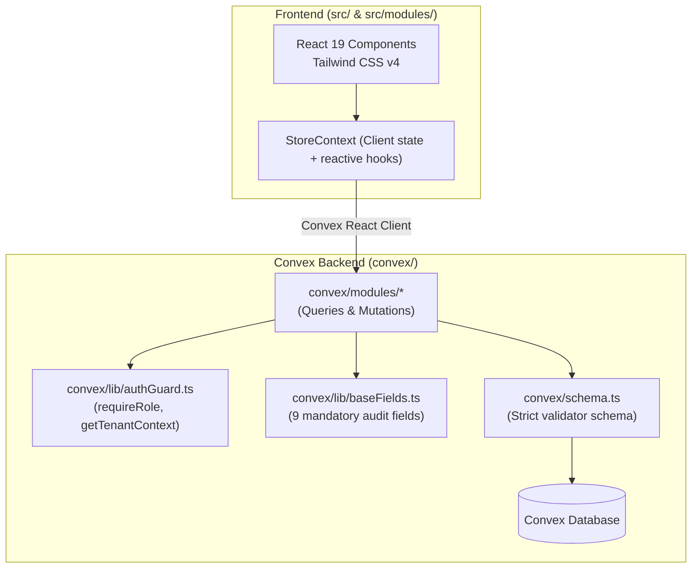

# System Architecture

## Architecture Overview
The repository follows a strict Three-Layer Architecture:
1. **Specs Layer (`modules/<module>/`)**:
   - Markdown documents governing requirements (`MODULE.md`), data dictionaries (`collections/*.md`), and verification checklists (`QA.md`).
2. **Frontend Layer (`src/modules/<module>/`)**:
   - React 19 SPA built with TypeScript, Tailwind CSS v4, Lucide icons, and Vite.
3. **Backend Layer (`convex/modules/<module>/`)**:
   - Reactive backend powered by Convex 1.51+, featuring automatic schema validation, database indexes, and end-to-end type safety.



## Shared Security & Invariants
- **Multi-Tenancy**: Every application table in `convex/schema.ts` includes `tenantId: v.id("tenants")` (or optional self-reference on `tenants`). Every query and mutation scopes reads and writes strictly by `tenantId`.
- **9 Mandatory Base Fields**: Injected into every collection via `convex/lib/baseFields.ts`:
  - `createdBy: Id<"users">`
  - `editedBy: Id<"users">`
  - `dateCreated: number`
  - `dateEdited: number`
  - `category: string`
  - `type: string`
  - `keywords: string[]`
  - `status: string`
  - `sysState: string`
- **Server-Side Authorization**: Caller identity is derived on the server using `getAuthUserId(ctx)`. Client-supplied user IDs are never trusted for authentication or authorization.

## Directory Structure
```
nursery_app/
├── AGENTS.md                  # Root execution rules and commands
├── BASELINE.md                # System invariants, roles, states, and modules
├── docs/                      # Architectural, API, and deployment documentation
├── modules/                   # Module specifications, schemas, and QA checklists
│   ├── admin/
│   ├── cart/
│   ├── catalog/
│   ├── orders/
│   └── storefront/
├── src/                       # Frontend source
│   ├── components/            # Shared UI and layout components
│   ├── context/               # Global store state and reactive bindings
│   ├── modules/               # Feature-specific UI screens
│   └── types/                 # Shared TypeScript models
└── convex/                    # Backend source
    ├── lib/                   # Base fields and auth guard helpers
    ├── modules/               # Feature queries, mutations, and actions
    └── schema.ts              # Database schema definitions
```
