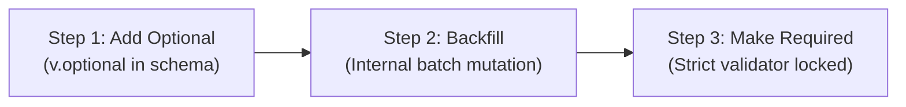

# Safe Schema Migrations

## Overview
Convex databases operate on live, typed documents. To prevent breaking live production traffic and ensure zero downtime, schema changes must follow the 3-step additive migration pattern.

## 3-Step Safe Migration Pattern



### Step 1: Add Field as Optional
When introducing a new required field, never declare it as required initially. Add it as `v.optional(...)` in `convex/schema.ts` and update the markdown collection file in `modules/<module>/collections/<collection>.md`:
```typescript
// convex/schema.ts
products: defineTable({
  // New field introduced as optional
  careLevel: v.optional(v.string()),
  ...
})
```
Deploy this schema change. Existing rows without the field remain fully valid and old client versions continue functioning without errors.

### Step 2: Backfill Data
Create and run an internal Convex mutation or scheduled migration script that iterates over historical documents in batches and writes default values:
```typescript
// Migration mutation
for (const product of batch) {
  if (product.careLevel === undefined) {
    await ctx.db.patch("products", product._id, { careLevel: "Moderate" });
  }
}
```
Run this migration until transaction metrics confirm 100% of rows are populated.

### Step 3: Make Field Required
Once all documents contain the new property, update the validator in `convex/schema.ts` from `v.optional(...)` to required, and update the markdown collection specification:
```typescript
// convex/schema.ts
products: defineTable({
  careLevel: v.string(), // Now strictly required
  ...
})
```
Deploy the finalized schema. Convex will guarantee type safety across all future writes.

## Large Index Considerations
When adding indexes to large existing tables, use `.index("by_field", { fields: ["field"], staged: true })` to prevent deploy blockage while the index builds in the background. Once built, remove `staged: true` in the subsequent deploy.
